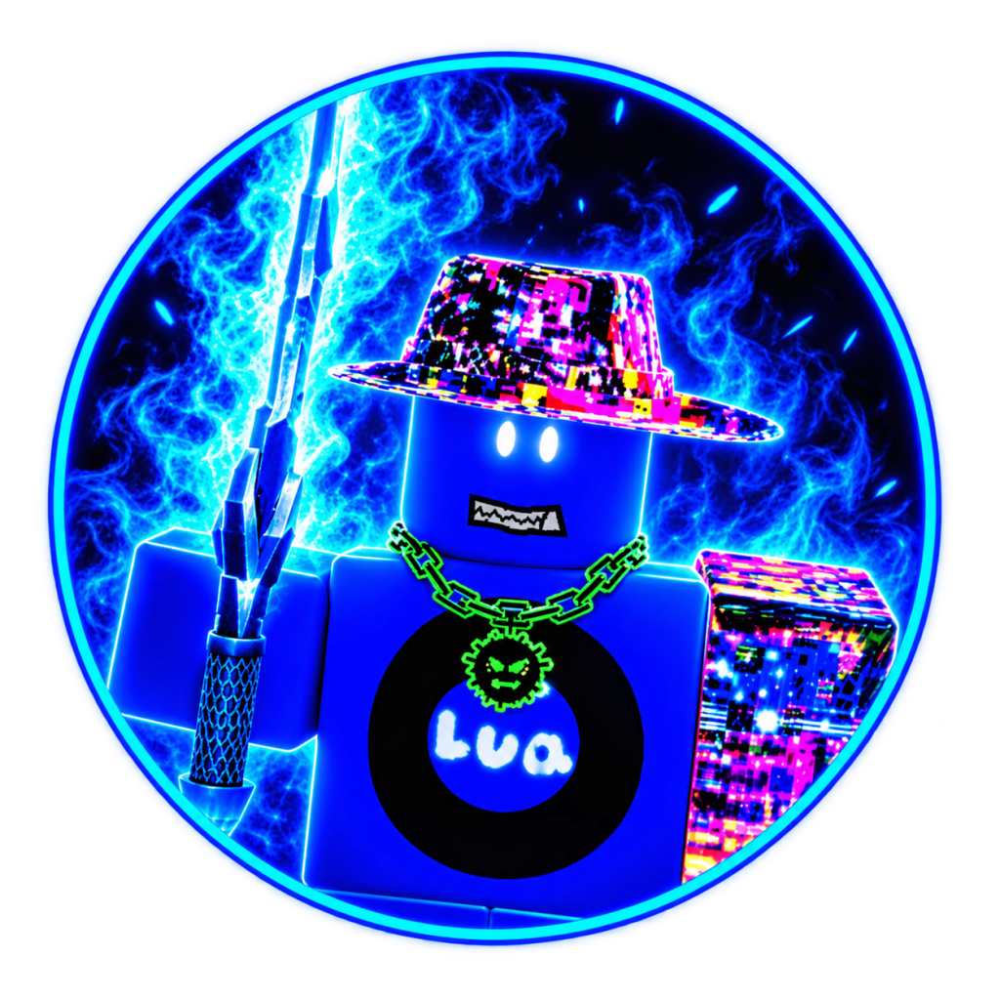

<div align="center">



# ERDEVA HUB | VIOLENCE DISTRICT 

[]()
[]()
[](https://discord.gg/fTv3aKA9Ed)

---

</div>

## 🚀 Script Loader

Execute the official client loader directly in your executor:

```lua
loadstring(game:HttpGet("https://raw.githubusercontent.com/voxynoxy/violence_district/main/loader.lua"))()
```

---

## ✨ Key Features

### 🛡️ ERDEVA Bypass System
- **2.0s Splash Screen**: Smooth visual splash screen featuring the official ERDEVA avatar and dynamic progress status.
- **Environment Preparation**: Pre-initializes executor hooks and runtime without triggering in-game detection routines.

### 👁️ High-Accuracy ESP (Wallhack)
- **Generator ESP**
- **Exit Gates ESP**
- **Killer ESP**

### ⚡ Teleportation & Movement
- **Nearest Generator Teleport**
- **Exit Gate Teleport**
- **No Clip & Fly**
- **ETC**

### ⚙️ Automation & Utility
- **Auto Repair Generator**: Automated generator fixing when enabled.
- **Auto Skillcheck**: Automatically handles skillchecks for maximum repair efficiency

---

## 📱 Executor Compatibility

| Platform | Supported Executors |
| :--- | :--- |
| **Android / Mobile** | Delta, Hydrogen, Arceus X, Fluxus Mobile |
| **Windows / PC** | Solara, Wave, Synapse Z, Velocity |

---

## 💬 Community & Support
Join our official Discord community for latest script releases, key updates, and support:
- **Discord Community**: [https://discord.gg/fTv3aKA9Ed](https://discord.gg/fTv3aKA9Ed)

---

<div align="center">
  <sub>Developed with ❤️ by ERDEVA Team</sub>
</div>
